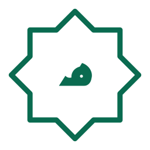

<div align="center">

<picture>
  <source media="(prefers-color-scheme: dark)" srcset="public/logo/makkah-mark-reverse.svg">
  
</picture>

# مكة &nbsp;|&nbsp; Makkah

**Arabic-first financial operations platform**
for merchants, invoices, collections, payment allocations, and auditable balances.

<div dir="rtl">

**منصّة عربية لإدارة التجار والفواتير والتحصيل بثقة**

</div>

<br>


-0A6B50?style=flat-square&logo=postgresql&logoColor=white)


[**Quick start**](#quick-start) ·
[**Features**](#features) ·
[**Architecture**](#architecture) ·
[**Verification**](#verification) ·
[**Production**](#production-notes)

</div>

<br>

---

## Quick start

Docker Compose is the supported development entry point. From this directory:

```powershell
docker compose up --build
```

Compose starts PostgreSQL, waits for its health check, applies the committed Prisma migrations, seeds local sample data, then runs Next.js.

| What | Where |
| --- | --- |
| Arabic dashboard (RTL) | <http://localhost:3000/ar/dashboard> |
| English interface (LTR) | <http://localhost:3000/en> |
| Roadmap (implemented / partial / coming soon) | `/ar/roadmap` |
| Health check | `/api/health` |

> Routes without a locale redirect to Arabic.

### Local seed account

| Field | Value |
| --- | --- |
| Email | `owner@makkah.eg` |
| Password | `Makkah-Local-2026!` |

> [!WARNING]
> These are local development defaults only. Set your own values in a `.env` file before sharing the environment or deploying it. `.env.example` documents the available variables. Do not reuse the Compose fallback secrets in production.

To enable Makka AI, set `MAKKA_AI_PROVIDER` to `openai`, `groq`, or `grok`, add that provider's secret API key to `MAKKA_AI_API_KEY`, and optionally set `MAKKA_AI_MODEL`. For Groq, use its model ID (for example, `openai/gpt-oss-120b`). Keep the key on the server and never expose it with a `NEXT_PUBLIC_` variable.

### Useful commands

```powershell
docker compose logs -f app
docker compose exec app npx prisma migrate dev --name describe_change
docker compose exec app npm run db:seed
docker compose down
```

`docker compose down` retains the PostgreSQL named volume. `docker compose down -v` also permanently deletes local database data.

---

## Features

<table>
  <tr>
    <td align="center" width="33%">
      <br>
      <b>Merchants</b><br>
      <sub>Directory, search, detail summaries, and permission-checked creation, atomic with its audit event.</sub>
    </td>
    <td align="center" width="33%">
      <br>
      <b>Invoices</b><br>
      <sub>Audited creation, draft editing, and cancellation, with line snapshots.</sub>
    </td>
    <td align="center" width="33%">
      <br>
      <b>Collections</b><br>
      <sub>Allocate payments to confirmed invoices, or reverse them with a required reason.</sub>
    </td>
  </tr>
  <tr>
    <td align="center">
      <br>
      <b>Balances</b><br>
      <sub>Outstanding amounts derived from confirmed invoices and active allocations, never stored as a total.</sub>
    </td>
    <td align="center">
      <br>
      <b>Reports &amp; imports</b><br>
      <sub>Filter by Cairo calendar date and merchant, export CSV; XLSX/CSV invoice imports with validation previews.</sub>
    </td>
    <td align="center">
      <br>
      <b>Audit trail</b><br>
      <sub>Server-side search with actor, action, entity, and date filters, plus before/after details.</sub>
    </td>
  </tr>
</table>

### Current foundation

- **Stack:** Next.js App Router, strict TypeScript, Tailwind, and a responsive Arabic/English workspace.
- **Auth & access:** Credentials authentication using bcrypt password hashes, short-lived encrypted JWT sessions, protected routes, and database-backed granular RBAC checks.
- **Data model:** PostgreSQL / Prisma models for users, roles, permissions, merchants, products, invoices, invoice line snapshots, payments, allocations, audit events, and spreadsheet import batches.
- **Exact money:** Financial amounts use PostgreSQL `NUMERIC(12,2)` / Prisma `Decimal`, not JavaScript floating-point arithmetic. Outstanding balances are derived from confirmed invoices and active payment allocations.
- **Integrity:** Financial records use restrictive foreign keys; audit events are protected against updates and deletion by a PostgreSQL trigger.
- **Seed data:** An owner account, the Owner/Admin/Collector/Viewer roles, sample merchants and financial activity.
- **Dashboard:** Live aggregate balances, collections, top debtors, and recent audit events from PostgreSQL.
- **Administration:** User and custom-role management enforces granular permissions and protects the final active owner account.
- **Makka AI:** Optional read-only workspace assistant supporting OpenAI, Groq, or xAI Grok. It retrieves only the data relevant to a question and allowed by the signed-in user's database permissions; configure `MAKKA_AI_PROVIDER`, `MAKKA_AI_API_KEY`, and `MAKKA_AI_MODEL`. Relevant retrieved data is sent to the configured provider for response generation. The assistant cannot perform platform actions.
- **Security:** Login failures, successful logins, and logouts are written to the audit trail; a persistent 15-minute account/IP attempt limit protects credential checks. Security headers are set centrally.
- **Operations:** `/api/health` checks database connectivity.

---

## Brand

Branding uses the supplied logo, favicon, icon, palette, and pattern assets in [`public/`](public), sourced from the Makkah brand kit.

<div align="center">

<picture>
  <source media="(prefers-color-scheme: dark)" srcset="public/logo/makkah-mark-reverse.svg">
  
</picture>
&nbsp;&nbsp;

&nbsp;&nbsp;


| Deep emerald | Primary | Muted | Light | Gold | Light gold | Ink |
| :---: | :---: | :---: | :---: | :---: | :---: | :---: |
|  |  |  |  |  |  |  |

</div>

| Folder | Contents |
| --- | --- |
| `public/logo/` | Marks (color, reverse, mono, mono-white, outline) and lockups |
| `public/app/` | Favicon, app icon, sidebar mark, pattern tiles, login background, OG card |
| `public/icons/` | 28 UI icons, 24×24, `stroke="currentColor"` (plus `_sprite.svg`) |
| `public/icons-badge/` | Six Makkah section badges used in the merchants, invoices, payments, debts, reports, and audit page headings |

> The lockups and OG card contain live text: install **Reem Kufi** and **Plus Jakarta Sans**, or convert the text to outlines.

---

## Architecture

```text
src/
  app/                 Next.js routes, layouts, and HTTP handlers
  components/          Shared presentation components
  features/
    dashboard/         Dashboard queries and business-facing aggregation
    finance/           Exact-decimal business calculations
  lib/                 Authentication, authorization, i18n, Prisma, formatting
prisma/
  schema.prisma        Relational domain schema
  migrations/          Versioned PostgreSQL migrations
  seed.ts              Idempotent development seed
public/
  logo/  app/  icons/  icons-badge/   Makkah brand kit
```

> [!IMPORTANT]
> Financial writes should be implemented in feature services and committed with their audit event in the same Prisma transaction. Do not store a merchant debt total: the invoice and allocation records remain the financial source of truth.

---

## Verification

```powershell
npm run typecheck
npm test
docker compose ps
```

---

## Production notes

The Compose file and Dockerfile provide a local development environment and a multi-stage standalone Next.js image. Before production deployment, supply:

- unique high-entropy `AUTH_SECRET` and database credentials
- TLS termination
- a managed, backup-enabled PostgreSQL instance
- monitoring
- an operational secret-management process

Sample account credentials are development-only. Database migrations are explicit and are not applied by Prisma schema synchronization.

---

<div align="center">



<sub>مكة · Makkah — built Arabic-first.</sub>

</div>